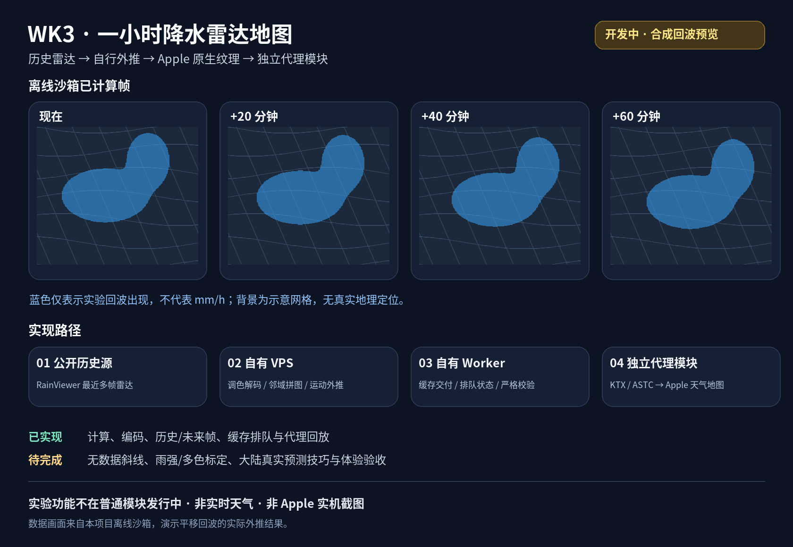

# WeatherKit-WK3

让代理在设备本机处理 Apple 天气的 WK3 数据：空气质量、雨雪分钟预报、昨日对比和原生预警详情。**当前、逐日和逐小时天气继续使用 Apple 原始数据。**

[模块安装与参数说明](modules/README.md) · [发行记录](CHANGELOG.md) · [上游项目](https://github.com/NSRingo/WeatherKit) · [实验雷达地图](#一小时降水雷达地图开发中)

## 相比上游正式版

对比基线为 [NSRingo/WeatherKit v3.3.2](https://github.com/NSRingo/WeatherKit/releases/tag/v3.3.2)（截至 2026-11-08 的最新非预发行版）。本 Fork 以该版本为基础；部分 WK3 模型和处理方式参考上游 **dev**，不把上游测试版已有能力宣称为本项目独创。

| 项目 | 本 Fork 的差异与支持范围 |
| --- | --- |
| WK3 本机处理 | 提供 Egern、Surge、Loon、Stash 的 WK3 专用构建；共用业务核心，保留未处理的数据槽。Quantumult X 二进制天气仍透传。 |
| 空气质量 | 按上游 dev 的独立 AQ 入口处理，不套用普通天气的大陆范围；优先使用 Apple 已有污染物，缺失时查询所选来源。支持完整 AQ 转换、缺失补入和单位转换。 |
| 内置算法 | 11 种计算算法及 `None`；包括欧盟 EAQI、UBA、美标／国标 InstantCast、加拿大／香港 AQHI 和风险算法。保留本 Fork 对加拿大单位、指数取整及超量程连续性的修正。 |
| 欧盟标尺 | 与上游 dev 一样使用无版本 `EU.EAQI`，请求 Apple 原生标尺；不再用本地色带覆盖名称与渐变。 |
| 雨雪分钟预报 | WK3 分钟数据编码与缺失补入，参考上游 dev 的雨雪枚举；修复和风坐标、预报起点及有效期处理。轻雪未命名文字条件可省略，分钟强度和雪摘要保留。 |
| 预警详情 | 补全 Apple 已有事件，保留原 UUID，匹配后进入 Apple 原生详情页面；支持上游定义的红橙黄蓝等级。泛称“恶劣天气”在同地区页面、同等级、同发布时间且候选唯一时推断具体事件。 |
| 客户端兼容 | Egern 原生 `ctx`，Surge／Loon 原生字节回传，其他平台独立适配；错误或未知结构保留原数据。 |
| 参数与日志 | Egern／Surge／Loon／Stash 共用中文指数来源与算法选项、简短说明，兼容旧内部值；分别记录预警摘要、详情转换和回退原因，敏感配置不明文输出。 |

上游 dev 与本 Fork 的实现并非完全相同。已有 AQ 的完整替换、事件 UUID 关联、宿主二进制返回等应以本仓库实现及平台说明为准。

## 安装

使用文件名包含 **`.WK3.`** 的发行附件，不要与旧 Rewrite 模块或测试模块重复启用。模块会自动加载同一版本、同一客户端的脚本，无需单独导入 JS。

| 客户端 | 下载 | 说明 |
| --- | --- | --- |
| Egern | [WK3.yaml](https://github.com/patrickyanxxxxx/WeatherKit-WK3/releases/latest/download/iRingo.WeatherKit.WK3.yaml) | 参数面板；本轮原生欧盟标尺测试版已获用户实机确认。 |
| Surge | [WK3.sgmodule](https://github.com/patrickyanxxxxx/WeatherKit-WK3/releases/latest/download/iRingo.WeatherKit.WK3.sgmodule) | 模块参数；原生二进制回传已有实机验证。 |
| Loon | [WK3.lpx](https://github.com/patrickyanxxxxx/WeatherKit-WK3/releases/latest/download/iRingo.WeatherKit.WK3.lpx) | 插件参数；二进制及缺 AQ 补入已有测试版实机验证。 |
| Stash | [WK3.stoverride](https://github.com/patrickyanxxxxx/WeatherKit-WK3/releases/latest/download/iRingo.WeatherKit.WK3.stoverride) | 编辑首条脚本的 `argument`，其他四条共享；当前以脚本回放验证为主。 |
| Quantumult X | [WK3.snippet](https://github.com/patrickyanxxxxx/WeatherKit-WK3/releases/latest/download/iRingo.WeatherKit.WK3.snippet) | 请求／文本路径可用；**WK3 二进制天气不转换**，无模块参数面板。 |

启用 MITM 并信任证书。普通模块处理 `weatherkit.apple.com`；独立雷达模块另行安装。Shadowrocket 暂无经过验证的本机 WK3 模块。

## 默认参数与使用要点

以下为可配置 WK3 模块的默认值，**更新不一定覆盖设备上已保存的选项**。Egern／Surge／Loon／Stash 的指数来源与算法显示中文，括号内为内部值。

| 设置 | 默认值 | 作用 |
| --- | --- | --- |
| 今日空气指数来源 | iRingo内置算法（`Calculate`） | 使用污染物本地计算；也可选彩云美标、彩云国标或和风。 |
| 内置算法 | 欧盟 EAQI（`EU_EAQI`） | 11 种算法加 `None`；仅选择内置算法来源时使用。 |
| 指数替换目标 | `HJ6332012` | **原始标准**，不是目标标准；空值或 `[]` 停用指数替换。 |
| 今日污染物来源 | 彩云（`ColorfulClouds`） | 已有 Apple 污染物优先保留，缺失时才取此来源。 |
| 污染物单位 | 目标 `[]`、模式 `Scale` | 默认不额外转换；配置目标后按标准或指定单位处理。 |
| 昨日指数来源 | 彩云美标（`ColorfulCloudsUS`） | 直接同源比较；今日显示标准不同时，按上游流程比较该来源自己的今日／昨日趋势，并标注来源。 |
| 昨日污染物来源 | 和风（`QWeather`） | 内置算法计算昨日值所需的来源；须有真实历史浓度。 |
| 指数改变时重算已有趋势 | `false` | 保留有效原比较；未知趋势在转换时尝试补齐。 |
| 国标强制显示主要污染物 | `true` | 不超过 50 时也显示主要污染物。 |
| 允许内置指数超标 | `true` | 不取消输入与线格式范围检查；超出可编码范围时保留原响应。 |
| 下一小时雨雪来源 | 彩云（`ColorfulClouds`） | 单点分钟预报，不是二维雷达地图。 |
| 预警来源 | 和风网页（`QWeatherWeb`） | 严格匹配 Apple 已有事件，不凭空增加预警。 |
| 普通天气范围／逐日逐小时替换 | `CN`／`false`、`false` | WK3 当前、逐日、逐小时数据仍透传。 |
| 网络超时／日志 | 8000 毫秒／`INFO` | 单次来源请求超时；`OFF` 关闭日志。 |

**算法切换：**先选“iRingo内置算法”，再选算法。已有 AQ 的原始标准须命中替换目标；如果 Apple 已返回美标，只有 `HJ6332012` 不会替换它，可按需加入 `EPA_NowCast`。不要把修改算法选项误认为无条件覆盖所有地区和标准。

**地区与来源：**AQ 不要求改国家码。台北／澳门有 Apple 污染物时可直接计算；缺数据时必须选真正支持该地区的来源。上游彩云 AQ 列表为 CN／HK／MO，TW 缺数据应选和风并配置有效 API；不承诺默认彩云对所有台北响应补入。来源失败不伪造有效数据。当前预警和分钟增强的普通地区范围仍有大陆限制。

**昨日比较：**有历史浓度才可重算算法。彩云历史接口给出的类别不能反推 UBA／EAQI／AQHI 的昨日浓度；无数据则趋势未知，今日指数仍可用。不同标准绝不直接比较数值。Quantumult X 无参数注入时使用同一套模块默认值，但其 WK3 二进制响应始终不转换。

完整 23 项参数见 [模块 README](modules/README.md)。

## 一小时降水雷达地图（开发中）

**这是独立实验功能，不包含在普通 WK3 模块中，也不是本次正式发行的新能力。** 当前阶段目标为中国大陆。上图使用离线沙箱的合成平移回波，展示时间序列和架构，非实时天气、非雨强预测，也不是 Apple 天气实机截图。

实现路径：

1. 读取 RainViewer 公开历史雷达与覆盖信息；免费历史源不直接提供未来预测。
2. 在用户自己的 VPS 上解码调色板、拼接邻域，用最近多帧估计运动并平流外推，计算未来约一小时的瓦片。
3. 编码成 Apple 地图可读取的 KTX／ASTC 纹理，经用户自己的 Cloudflare Worker 提供受校验的接口。
4. 独立代理模块仅替换匹配的雷达帧；普通 AQ、预警、分钟雨仍在代理本机处理，不绕行 VPS。

| 阶段 | 当前进度 |
| --- | --- |
| 数据解码、拼图、运动估计、外推、纹理编码 | 已实现；离线沙箱可以复跑真实计算链路。 |
| 历史／未来帧交付、缓存复用、排队状态及错误回退 | 已实现并做网关／Worker／代理回放测试。 |
| Apple 地图原生交付 | 历史和未来实验纹理已有手机接收证据；已显示实验回波，但**不等于覆盖与预测质量验收**。 |
| 无数据斜线与局部未知区域 | 尚未解决最终显示闭环；不伪造覆盖，不把缺测当无雨。 |
| 多色与物理雨强 | 当前交付仍为二值回波，不能解释为 mm/h；标定和显示待完成。 |
| 中国大陆真实预测技巧与多客户端体验 | 尚未完成多独立天气过程验收；已有诊断中仍有退化，不宣称一小时准确预报。 |

实验源码位于 [`feat/cloudflare-radar`](https://github.com/patrickyanxxxxx/WeatherKit-WK3/tree/feat/cloudflare-radar)。目标是**用户自部署 Worker＋自有 VPS**，没有公共默认后端；不把任何个人演示服务当产品默认。当前离线沙箱主要验证 Surge 宿主，其他客户端仍需对应设备验收。

## 限制、安全与开发

- 预警失配、候选歧义、缺失原发布时间或未知结构时保留原链接；泛称匹配是受约束推断，不是单靠标题精确识别。
- 未命名轻雪文字条件省略时可能连带省略其他文字段；分钟数值和雪摘要保留。编码通过不等于每种天气都已获手机显示验收。
- 部分城市 UV 防晒时段建议可能仍为英文；不改语言或伪造当前天气。
- 来源令牌只在设备参数配置；不提交抓包、位置日志、Apple 认证或个人后端凭据。
- `src/wk3/` 为共享业务，`src/platform/` 为宿主适配；参数见 `src/wk3/parameters.mjs`，平台模块由模板统一生成。
- `npm run test:wk3` 运行回归；`npm run build:wk3 -- --outdir dist` 生成脚本；带 `--version 3.3.8` 生成同版本五模块。构建不会自动创建标签或发行版。
- 保留上游及 Horatio／PR #107 等来源与 Apache-2.0 署名。上游私有包需要相应 GitHub Packages 读取权限；依赖安装失败不能当作测试通过。

发行差异统一放在 [CHANGELOG](CHANGELOG.md) 和每次 Release 正文，首页不再堆叠逐版更新记录。
