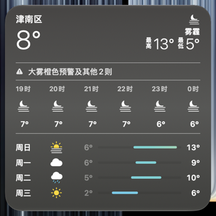

# WK3 FlatBuffer 天气替换

本分支接入 `NSRingo/apple.WeatherKit` 的完整 WK3 schema 与 `WK3.Codec`，在
`Response.dev.mjs` 中替换当前、逐日、逐小时天气。`WeatherKit3.mjs` 保留产品注册和
供应商数据形态适配，字段布局与枚举读写统一由协议包负责。

## 三个 PR 的衔接

- [apple.WeatherKit #1](https://github.com/NSRingo/apple.WeatherKit/pull/1) 提供 Schema/Codec；
  协议包只负责表示层，不管理请求或供应商。
- [WeatherKit #110](https://github.com/NSRingo/WeatherKit/pull/110) 负责 JSON 协商和 JSON 响应。
  符合地区、供应商、数据集设置的主 App 请求继续协商 `Accept: application/json`。
- [WeatherKit #111](https://github.com/NSRingo/WeatherKit/pull/111) 按实际响应 Content-Type
  处理 WK3 FlatBuffer；不修改 Request.dev.mjs，也不覆盖 #110 的 Accept 选择。

正常主 App JSON 响应在 JSON 分支返回，二进制 decoder/encoder 不执行；每个产品
只调用一次供应商。仍收到 FlatBuffer 的请求进入本 PR 的产品替换与原始数据保留链。
这让两种格式共享既有产品注入函数，不需要第二套客户端白名单或自动重试协议。

建议保留上述 JSON 优先策略，由维护者确认长期路线。下方主 App 二进制验收使用专用
测试模块保留原生 Accept，用于证明 codec 与原生客户端兼容，不表示切换主 App 默认路由。
macOS 小组件已通过下方二进制实测，本轮保留 FlatBuffer 路径，暂不扩展 JSON 白名单。

## 合并顺序

#110 和协议包 #1 可分别审阅。#111 保持 Draft，等待 #1 发布，再更新协议依赖及
lockfile、同步已合并的 #110、重跑组合验证后合并。现有 2.0.5 没有 WK3.Schema/Codec，
本分支暂时使用协议包源码构建产物验证。

本分支的 cloudCover 修复与 #110 相同，同步到已合并 #110 的 dev 后消除这部分重复。
样本说明使用独立文件名，避免两个 PR 同时新增 README 的冲突。

## 验证

本地使用协议包分支生成的 `dist/index.js` 替换本 worktree 的
`node_modules/@nsringo/weatherkit/dist/index.js`，package.json 和 lockfile 未修改。
协议包发布前可按这一方式复现；两个仓库的分支名均为 `codex/wk3-binary-codecs`。

```sh
# 在 apple.WeatherKit 中
npm run WK3
npm run tsc
npm test
npm run build

# 在 WeatherKit 中，协议包位于相邻的 ../apple.WeatherKit
cp ../apple.WeatherKit/dist/index.js node_modules/@nsringo/weatherkit/dist/index.js
node --test tests/*.test.mjs
npm run build
npm run build:dev
```

- 协议包 26 项测试通过；主仓库 141 项测试通过，正式和开发构建通过。
- 回归用例验证三类天气注入、供应商失败时单产品保留、未来字段保留，以及未选中产品
  的完整原始 arena 逐字节保留。关闭替换或选择 WeatherKit 时响应逐字节不变。
- 2026-11-14，macOS 27.3 (26C5035r) + Surge 6.12.0，成都、苏州主 App 实测请求和响应
  均为 `application/vnd.apple.flatbuffer;messageType=WK3.Weather`。
- 成都响应：当前 17.20°，今日 18.81° / 12.03°；彩云逐日 11 项、逐小时 274 项。
- 苏州响应与页面对齐如下；当前、逐日、逐小时 metadata.providerName 均为彩云天气。

| 项目 | 二进制解码值 | 页面显示 |
| --- | --- | --- |
| 当前温度 | 18.16° | 18° |
| 今日最高 / 最低 | 18.16° / 16.41° | 18° / 16° |
| 17 时 | 18.00° | 18° |
| 18 时 | 17.68° | 18° |
| 19 时 | 17.49° | 17° |

## 组合验证

将 #110 的 JSON 改动与本分支合并到独立 checkout，并使用协议包 #1 的构建产物。
组合回归覆盖主 App JSON 协商、JSON 不进入 binary codec、每个产品只调用一次供应商、
未协商 JSON 的 Widget 请求保持 FlatBuffer，以及新旧 schema 的成对样本对照。
组合后的 161 项测试全部通过（0 跳过），正式和开发构建通过。对应提交见 PR 正文。

## macOS 小组件实测（2026-11-14）

macOS 27.3（26C5035r）、Surge 6.12.0（12840）。主 App 隐藏，用户在桌面小组件中
依次选择天津市津南区、昆明市、福州市，再恢复原来的当前位置。三次抓到的请求进程均为
`WeatherWidget`，UA 均为 `WeatherKit_WeatherWidget_macOS_Version 27.3 (Build 26C5035r)`。
Accept 和响应 Content-Type 均为 `application/vnd.apple.flatbuffer;messageType=WK3.Weather`。

| 地点 / 请求时间（UTC+8） | 当前温度：解码 → 显示 | 当日高 / 低：解码 → 显示 | 成功构建 timeline |
| --- | --- | --- | --- |
| 天津市津南区 / 18:50:29 | 7.74° → 8° | 13.42° / 5.07° → 13° / 5° | 2 次 |
| 昆明市 / 18:54:16 | 16.44° → 16° | 18.65° / 9.36° → 19° / 9° | 2 次 |
| 福州市 / 18:54:27 | 22.07° → 22° | 23.10° / 22.00° → 23° / 22° | 1 次 |

三次改写响应的当前、逐日、逐小时 metadata.providerName 均为彩云天气，分别含
10 天和 24 小时预报。请求完成后的原生日志成功获取天气并构建 timeline，观察窗口内
`failedToCreateResponseModel`、`Unable to decode`、`FlatbuffersErrors` 均为零。

津南区同时保存了像素截图；昆明、福州用原生 Accessibility 文本核对完整显示结果。
津南区 19–0 时温度的二进制值为 6.63、6.58、6.54、6.54、6.43、6.33°，
截图显示 7、7、7、7、6、6°。



因此本轮保留“主 App JSON、小组件 FlatBuffer”的分工，暂不扩展小组件 JSON 白名单。
Siri、地图、watchOS 等入口后续分别抓请求和验收。测试结束后恢复了原模块、当前位置
与原桌面，并移除了只针对 WeatherKit 的临时抓包规则。
